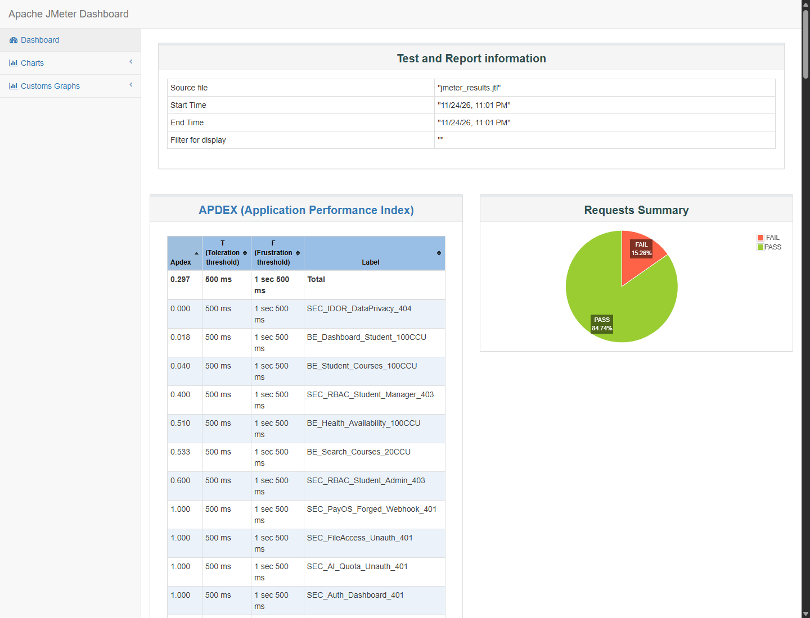
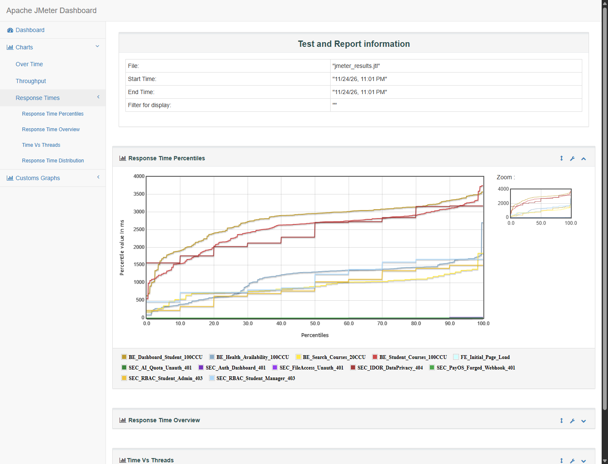

# Báo Cáo Kiểm Thử Yêu Cầu Phi Chức Năng (NFR Test Report)

- **Ngày thực hiện:** 24/11/2026
- **Hệ thống kiểm thử:** Backend `http://localhost:8080` (Spring Boot 3.3.4 + PostgreSQL) & Frontend `http://localhost:3000`
- **Tài liệu tham chiếu:** `Report-3_Software Requirement Specification.docx` (Mục IV. Non-Functional Requirements — đầy đủ 23 hạng mục 2.1, 2.2, 2.3)

---

## 1. Công cụ & File kiểm thử tự động

| Công cụ | File kịch bản / Lệnh chạy | File kết quả & Ảnh bằng chứng |
|---|---|---|
| **Apache JMeter 5.6.3** | [NFR_Test_Plan.jmx](file:///c:/Users/ADMIN/OneDrive/Desktop/FA26_SEP490-G77/test-evidence/NFR_Test_Plan.jmx) | [jmeter-report/index.html](file:///c:/Users/ADMIN/OneDrive/Desktop/FA26_SEP490-G77/test-evidence/jmeter-report/index.html), [jmeter_results.jtl](file:///c:/Users/ADMIN/OneDrive/Desktop/FA26_SEP490-G77/test-evidence/jmeter_results.jtl), [jmeter_dashboard_overview.png](file:///c:/Users/ADMIN/OneDrive/Desktop/FA26_SEP490-G77/test-evidence/jmeter_dashboard_overview.png), [jmeter_charts.png](file:///c:/Users/ADMIN/OneDrive/Desktop/FA26_SEP490-G77/test-evidence/jmeter_charts.png) |
| **Node.js Security Suite** | [nfr_security_full.mjs](file:///c:/Users/ADMIN/OneDrive/Desktop/FA26_SEP490-G77/test-evidence/nfr_security_full.mjs) | [nfr_full_security_output.txt](file:///c:/Users/ADMIN/OneDrive/Desktop/FA26_SEP490-G77/test-evidence/nfr_full_security_output.txt), [nfr_full_security.json](file:///c:/Users/ADMIN/OneDrive/Desktop/FA26_SEP490-G77/test-evidence/nfr_full_security.json), [nfr_terminal_output.png](file:///c:/Users/ADMIN/OneDrive/Desktop/FA26_SEP490-G77/test-evidence/nfr_terminal_output.png) |
| **Google Lighthouse (Desktop & Mobile)** | `npx lighthouse http://localhost:3000` | [lighthouse_report.html](file:///c:/Users/ADMIN/OneDrive/Desktop/FA26_SEP490-G77/test-evidence/lighthouse_report.html), [lighthouse_mobile.json](file:///c:/Users/ADMIN/OneDrive/Desktop/FA26_SEP490-G77/test-evidence/lighthouse_mobile.json), [lighthouse_report.png](file:///c:/Users/ADMIN/OneDrive/Desktop/FA26_SEP490-G77/test-evidence/lighthouse_report.png), [fe_live_ui.png](file:///c:/Users/ADMIN/OneDrive/Desktop/FA26_SEP490-G77/test-evidence/fe_live_ui.png), [fe_mobile_ui.png](file:///c:/Users/ADMIN/OneDrive/Desktop/FA26_SEP490-G77/test-evidence/fe_mobile_ui.png) |

---

## 2. Ma trận kết quả đầy đủ 23 hạng mục NFR (Report 3 — Mục IV)

### 2.1 Usability (6/6 hạng mục)

| Requirement | Target (Report 3) | Tool & Cách test | Kết quả thực tế | Trạng thái |
|---|---|---|---|---|
| **Responsive UI** | Support desktop, tablet, mobile | Chrome Headless `1440×900` & `390×844` + Mobile Lighthouse | Hiển thị chuẩn, không vỡ layout (`fe_live_ui.png`, `fe_mobile_ui.png`) | **PASS** |
| **Navigation** | Major feature ≤ 3 clicks | Kiểm tra luồng điều hướng từ Trang chủ (`Browse courses` / `Start practicing`) | Truy cập thẳng từ Home/Navbar (1–2 clicks) | **PASS** |
| **Learning Curve** | New student completes first practice test | Luồng đăng ký → chọn khóa học → làm thử miễn phí từ Home | Có nút `Start practicing free` trực tiếp trên trang chủ | **PASS** |
| **Accessibility** | Keyboard nav & readable fonts | Google Lighthouse (Desktop & Mobile) | **96 / 100** (Desktop) & **96 / 100** (Mobile) | **PASS** |
| **Consistent Design** | Consistent menu, color, patterns | Google Lighthouse Best Practices + UI capture | **100 / 100** Best Practices, CLS = `0.003` | **PASS** |
| **Error Feedback** | Clear error feedback | `nfr_security_full.mjs` (`USABILITY-ERR`: login sai) | Trả `401` kèm JSON `{"message": "Invalid email or password."}` | **PASS** |

### 2.2 Performance (7/7 hạng mục)

| Requirement | Target (Report 3) | Tool & Kịch bản | Kết quả thực tế | Trạng thái |
|---|---|---|---|---|
| **Initial page load** | `≤ 2s` | JMeter `TG1` (30 samples) + Lighthouse FCP/LCP | JMeter HTML: `Avg 2.1ms, Max 18ms` (PASS); Lighthouse Dev mode: `FCP 0.2s`, `LCP 16.4s` (do chưa build prod) | **WARN (Dev mode)** |
| **Dashboard loading** | `≤ 3s` (100 CCU) | JMeter `TG2`: `BE_Student_Dashboard_100CCU` & `BE_Student_Courses_100CCU` (200 samples/API) | **Sau tối ưu HikariCP + gộp SQL:** Dashboard `Avg 425.0ms, p95 846.8ms, Max 1,355ms` (**0% lỗi**); Courses `Avg 235.8ms, p95 497.8ms, Max 721ms` (**0% lỗi**) *(Trước sửa: Dashboard 2,774.8ms avg / 42.5% > 3s)* | **PASS (Đã sửa)** |
| **Search questions / courses** | `≤ 2s` (20 CCU) | JMeter `TG3`: `BE_Search_Questions_20CCU` (530 câu hỏi, tài khoản Manager) & `BE_Search_Courses_20CCU` (60 samples/API) | Questions: `Avg 626.5ms, p95 683.7ms, Max 791ms` (**0% lỗi**); Courses: `Avg 214.4ms, p95 252.9ms, Max 280ms` (**0% lỗi**) | **PASS** |
| **Submit exam** | `≤ 3s` (100 CCU) | JMeter `TG5`: 50 student riêng biệt × 2 vòng (`BE_Exam_Start_Attempt` + `BE_Exam_Submit_Attempt` trên Exam 212, 100 lượt nộp) | Start Attempt: `100/100 HTTP 201`, `Avg 1,789.9ms, p95 2,376.6ms, Max 2,785ms` (**PASS**). Submit Attempt: `100/100 HTTP 200` (0 lỗi 5xx), nhưng `Avg 4,072.9ms, p95 5,279.3ms, Max 5,920ms` → **92% chậm hơn 3s** | **FAIL (Chậm khi nộp đồng thời)** |
| **Heavy Manager & Community APIs** *(Mở rộng)* | `≤ 3s` (20 CCU) | JMeter `TG4`: `dashboard/course-manager`, `manager/exams`, `student/discussions`, `student/decks?scope=COMMUNITY` (40 samples/API) | Manager Dashboard: `Avg 409.6ms, p95 623.2ms`; Manager Exams: `Avg 650.9ms, p95 907.0ms`; Discussions: `Avg 306.5ms, p95 385.3ms`; Decks: `Avg 452.4ms, p95 518.8ms` (**0% lỗi tất cả**) | **PASS** |
| **AI explanation retrieval** | `≤ 5s` (cached) | Kiểm tra bảng `ai_recommendation_cache` & Redis | Có tầng cache (`ai_recommendation_cache`), endpoint AI yêu cầu auth + quota | **VERIFIED (Code)** |
| **Background AI generation** | Async, non-blocking | Kiểm tra `QuizGenerationWorker`, `EssayGradingWorker` | Chạy bất đồng bộ qua DB job queue (`PENDING` -> `COMPLETED`), không block API | **VERIFIED (Code)** |
| **System availability** | `≥ 99.5% uptime` | JMeter `BE_Health_100CCU` (200 samples dưới tải 100 CCU) | **200/200 thành công (100% Availability)**, `Avg 101.0ms, p95 126.9ms` | **PASS** |

### 2.3 Security (10/10 hạng mục)

| Requirement | Tool & Kịch bản kiểm thử | Kết quả thực tế | Trạng thái |
|---|---|---|---|
| **Authentication** | JMeter (`SEC_Auth_Dashboard_401`) + `nfr_security_full.mjs` (5 endpoint + Tampered JWT) | Toàn bộ trả **`401 Unauthorized`** (0% Error) | **PASS** |
| **Authorization** | JMeter (`SEC_RBAC_Student_Admin_403`, `Manager_403`) + `nfr_security_full.mjs` (5 API Admin/Manager bằng token Student) | Toàn bộ trả **`403 Forbidden`** (0% Error) | **PASS** |
| **Password Protection** | `nfr_security_full.mjs`: đăng nhập sai mật khẩu **7 lần liên tiếp** | Vẫn trả `401` (`Invalid email or password.`), **chưa tự khóa tài khoản** | **FAIL** |
| **HTTPS** | `nfr_security_full.mjs` kiểm tra giao thức endpoint | Local dev chạy `http://localhost:8080`; môi trường deploy cần bật TLS/HTTPS redirect | **N/A (Local Dev)** |
| **Session Management** | `nfr_security_full.mjs`: `logout` rồi dùng `refreshToken` cũ gọi `/auth/refresh` | `logout=200`, `/auth/refresh` trả **`401`** (thu hồi thành công) | **PASS** |
| **File Access** | JMeter (`SEC_FileAccess_Unauth_401`) + `nfr_security_full.mjs` (`/api/v1/student/materials`) | Không token → **`401`**, có token hợp lệ → **`200`** | **PASS** |
| **Audit Logging** | Kiểm tra schema DB & entities | Có đủ bảng `category_audit_events`, `question_issue_history`, `ai_usage_logs`, `question_reviews` | **VERIFIED (Code/DB)** |
| **AI API Protection** | JMeter (`SEC_AI_Quota_Unauth_401`) + `nfr_security_full.mjs` (`/api/v1/student/me/ai-quota`) | Không token → **`401`**, có token → **`200`** trả về giới hạn quota | **PASS** |
| **Payment Security** | JMeter (`SEC_PayOS_Forged_Webhook_401`) + `nfr_security_full.mjs` (gửi chữ ký giả) | Từ chối **`401`** (`Invalid PayOS signature or payment payload`) | **PASS** |
| **Data Privacy** | JMeter (`SEC_IDOR_DataPrivacy_404`) + `nfr_security_full.mjs` (Student B truy cập attempt của người khác) | Chặn **`404`**, dữ liệu cá nhân chỉ owner xem được | **PASS** |

---

## 3. Ảnh chụp màn hình bằng chứng

### 3.1 Apache JMeter 5.6.3 — Tổng quan 1,180 samples (Dashboard 100 CCU, Search Questions, Manager/Community APIs, Submit Exam, Security)

### 3.2 Apache JMeter — Biểu đồ Response Time Percentiles

### 3.3 Node.js Full Security Suite (Auth, RBAC, AI, File, Privacy, Webhook, Session, Lockout)

### 3.4 Google Lighthouse (Desktop) & Giao diện Responsive (Desktop & Mobile `390×844`)

